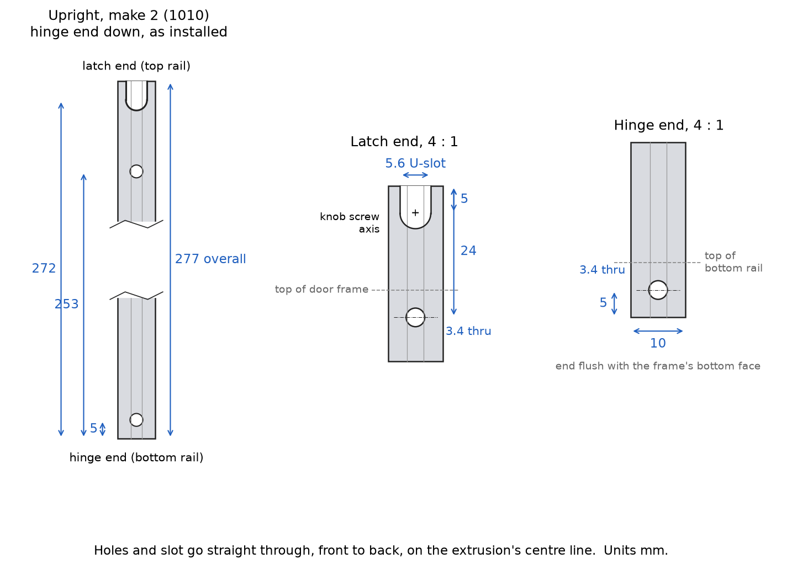
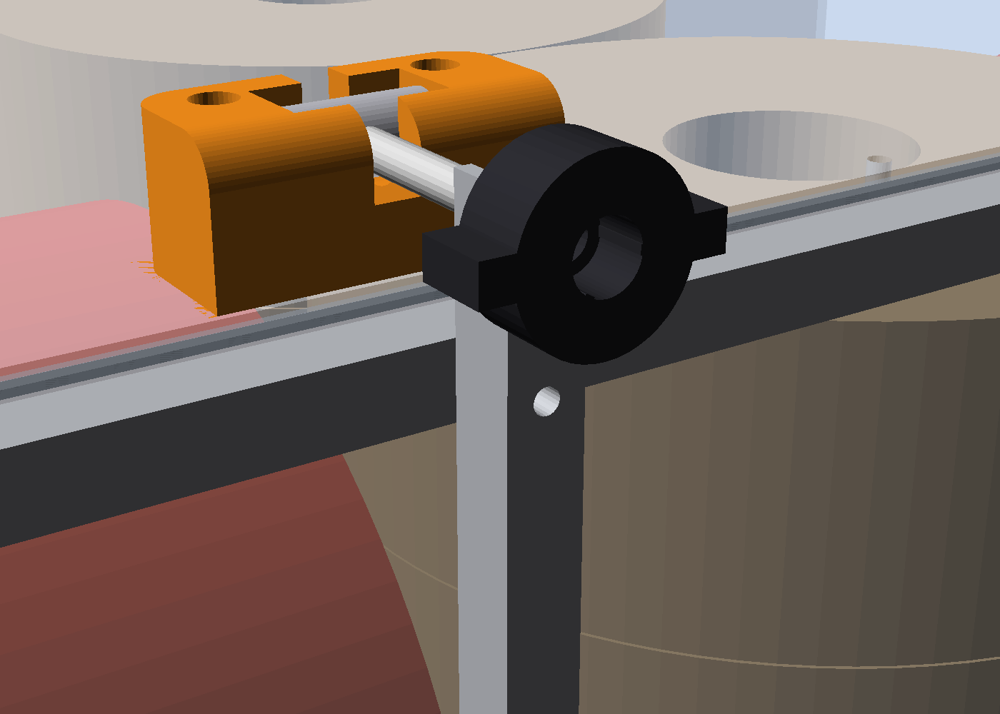
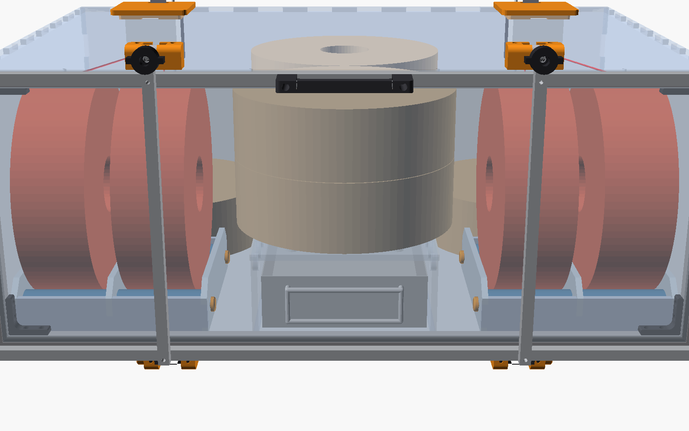

# Door uprights: cut and drill sheet (2026-11-21)

Two 1010 uprights replace the printed catches. Each lies on the outer faces of the door frame's
bottom and top rails, right under its latch, and its slotted top end takes the knob screw. The
knob's pull goes down the upright to the hinge rail instead of twisting the top rail.
Model: [`scad/2026-11-04_door_mounts.scad`](scad/2026-11-04_door_mounts.scad), part `"upright"`
(`uprights = false` draws the old catches).

| | |
|---|---|
|  |  |
| The knob bears on the upright's face | Uprights at 1/4 and 3/4, under the latches |

## Check first

With a door latched, measure from the top face of the door frame up to the center of the knob
screw. The model says **14**. If yours differs, move the slot's center (272) and the end (277) by
the same amount.

## Parts

| Qty | Part | Notes |
|---|---|---|
| 2 | 1010, 277 long | |
| 4 | M3 x 12 socket head + washer | one per rail per upright (12 = 10 + 2.5 rule) |
| 4 | 1010 T-nut | reuse 2 from the catches for the top rail; 2 new ones go in the bottom rail's outer slot |
| 2 | M5 knob, 45 thread | 10 longer than now: the knob bears 10 further out. Or the printed knob with an M5 x 45 socket head. |

Removed: the 2 printed catches and their 4 M3 x 6.

## Cut and drill (each upright)

All holes go straight through, front to back, on the center line. The slot opening in the
extrusion's face centers the bit; center punch anyway.

1. Cut to **277**. Square the ends; mark one as the hinge (bottom) end.
2. Drill **3.4** at **5** from the bottom end.
3. Drill **3.4** at **253** from the bottom end (24 from the top).
4. U-slot: drill **5.5 to 6** at **272** from the bottom end (5 from the top). Make two saw cuts
   from the top end down to the edges of that hole, 5.6 apart, and file the slot clean.
5. Deburr everything.

## Fit

1. Take off the catches. Slide one top-rail T-nut to each latch's center line; get a T-nut into the
   bottom rail's outer slot under each latch.
2. Bottom end flush with the frame's bottom face; screw on loosely at both rails.
3. Swing the knob screw into the slot to line the upright up, then tighten the M3s.
4. Fit the 45 knobs and latch.
5. The door sticks out 10 more at the uprights: check it still swings down and hangs where it did.

Units mm.
