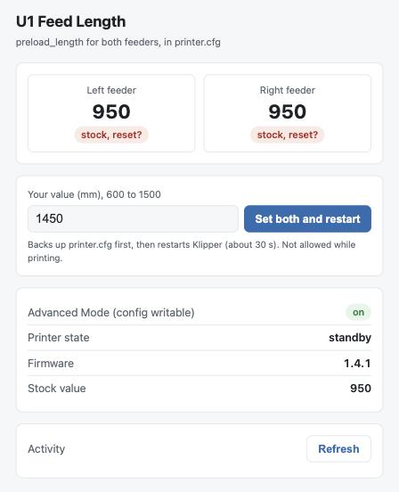

# U1 feed length: setting `preload_length` (2026-11-22)

When the U1's feeders move away from the printer (into this dry box, a BIQU PopStation, a rear
mount), the filament has further to go to reach the toolhead. The printer only pushes it a fixed
distance, 950 mm stock, so a load stops short. The fix is one setting, `preload_length`, in
`printer.cfg`. Snapmaker resets that file, so this guide also sets up a page on the printer that
shows the setting and puts it back with one button.



*The page as installed, before the change: both feeders at the stock 950, shown in red.*

Page source: [`tools/2026-11-22_feed_length.html`](tools/2026-11-22_feed_length.html). Checked on
firmware 1.4.1.

## What we found on the printer

- **The setting.** `printer.cfg` has `preload_length: 950` under both `[filament_feed left]` and
  `[filament_feed right]`. It is the most the feeder pushes, in mm.
- **The feeder stops early on its own.** In `filament_feed.py` the push ends as soon as the
  toolhead's filament sensor sees filament, so the value only caps the push. A value a little too
  big does no harm. There is also a 45 s time limit.
- **Limits: 600 to 1500.** `filament_feed.py` reads it with `minval=600, maxval=1500`. Above 1500
  Klipper refuses to start. A path longer than about 1450 needs that file patched (see the end).
- **The printer resets `printer.cfg` at every boot, not just on firmware updates.** The boot script
  `/etc/init.d/S48setup-lava-env` copies every config file back from
  `/home/lava/origin_printer_data/config/`. It skips the copy only if
  `/oem/printer_data/.fluidd` exists, and **Advanced Mode** on the touchscreen creates that file.
- **Without Advanced Mode the config is read-only.** Moonraker (the printer's web API) marks the
  config folder `r`, so Fluidd's editor can't save either. Advanced Mode makes it `rw`.

## One-time setup

### 1. Turn on Advanced Mode (touchscreen)

**Settings → Maintenance → Advanced Mode**, and accept. This keeps your edits across reboots and lets
the page save `printer.cfg`.

### 2. Turn on Root Access (touchscreen)

**Settings → Maintenance → Root Access**, scroll down and agree. This opens SSH, which you only need
to copy the page onto the printer. Snapmaker doesn't document these two menus, so the wording may
vary slightly between firmware versions.

### 3. Copy your SSH key to the printer (Mac or Linux)

```bash
ssh-copy-id root@u1.lan
```

The first time, it asks you to confirm the printer's key fingerprint (type `yes`), then asks for
the printer's password once; the community-reported default is `snapmaker`. After
this, `ssh root@u1.lan` logs straight in. Root with the default password is open to anyone on your
network, so consider changing it (`passwd` on the printer) once your key works.

No `.lan` name on your network? Use the printer's IP address instead (on the touchscreen, or in
your router's device list) everywhere this guide says `u1.lan`.

### 4. Install the page

From the repo folder:

```bash
scp tools/2026-11-22_feed_length.html root@u1.lan:/home/lava/fluidd/feed_length.html
```

That folder is where Fluidd's web pages live. The page has to be served from the printer: it talks
to Moonraker through Fluidd's own address, which avoids the browser's cross-site blocks. (Moonraker
can also serve files from the config folder, but it sends `.html` from there as a download, not a
page.)

### 5. Open it and bookmark it

```
http://u1.lan/feed_length.html
```

`u1.lan` is the name a Google/Nest Wifi router gives the printer (it's called U1); other routers may
use a different name or none. The printer's own mDNS name is `U1-<serial>.local`, not `U1.local`.

## Finding your value

Value = the extra tube you added + the path inside the printer + a margin, at most 1500.

For this dry box: 2.5 ft of PTFE (762) + 600 inside the printer = 1362. With margin: **1450**,
which is what the page starts with (`MY_PRELOAD` near the top of its script).

To measure your own path: run a load at the stock 950 and let it stop, mark the filament where it
enters the feeder, push it by hand until the toolhead's extruder grabs it, and measure from the
feeder to the mark. Your value is 950 plus that, plus about 20 to 90 of margin.

## Using the page

| Shows | Meaning |
|---|---|
| Left / right feeder | The `preload_length` in `printer.cfg` right now |
| `matches` (green) | Equals the value in the box |
| `stock, reset?` (red) | 950: firmware update, reboot without Advanced Mode, or never set |
| `differs` (amber) | Some other value |
| Advanced Mode `on` | Config is writable and edits survive reboots. `off`: the button stays disabled |
| Printer state | The button stays disabled while `printing` or `paused` |

**Set both and restart**, after a confirm:

1. Checks the printer isn't printing.
2. Copies `printer.cfg` to `printer-feedlen-<date>_<time>.cfg` in the config folder.
3. Changes the two `preload_length` lines and nothing else (tested: the diff is exactly those two
   lines).
4. Reads the file back to check, then restarts Klipper and waits until it's ready (about 30 s).

The box remembers the last value you set (in the browser), so after an update it's one tap.

## After every Snapmaker firmware update

1. Open `http://u1.lan/feed_length.html`.
   - **Page missing:** the update cleared Fluidd's folder. Re-run step 4 (and step 2 first if SSH is
     off again).
2. **Advanced Mode `off`:** turn it back on (step 1), then Refresh.
3. **Feeders red:** press **Set both and restart**.
4. Load one spool on each feeder before a long print.

## Doing it by hand

In Fluidd (`http://u1.lan`, Advanced Mode on): **Configuration → printer.cfg**, change both
`preload_length:` lines, **Save & Restart**. Or over SSH, edit
`/home/lava/printer_data/config/printer.cfg` and run `FIRMWARE_RESTART` from Fluidd's console.

To undo: copy a `printer-feedlen-*.cfg` backup over `printer.cfg` in Fluidd and restart.

## Troubleshooting

- **Chrome on a Mac: `ERR_ADDRESS_UNREACHABLE`** while Safari or Terminal reaches the printer:
  System Settings → Privacy & Security → Local Network → turn on Google Chrome, then restart Chrome.
- **Still stops short at 1450:** measure again (above). If your path is longer than about 1450,
  the 1500 cap in `/home/lava/klipper/klippy/extras/filament_feed.py` has to be raised (the
  `maxval` on the `preload_length` line). Back the file up first; a firmware update replaces it.
  The [PopStation feeder fix](https://github.com/Dr-Hack-N-Sniff/Snapmaker-U1-PopStation-Feeder-Fix)
  runs 1900 that way, and also skips a feeder wheel-speed check. Not needed for this box.
- **Klipper won't start after a change:** the value is probably outside 600 to 1500. Restore the
  backup in Fluidd and restart.

## Sharing it

Anyone with a U1 can use the same page. Change `MY_PRELOAD` to their value (or just type it in the
box), and do the one-time setup on their printer.
