# DryBoxU1

A sealed, desiccant-dried filament box for a **Snapmaker U1**, built to fill the middle bay of the
printer cart. Four spools spin on rollers and feed the U1's two feeders straight through the back
wall, six more spools wait in dry storage, and a stainless pan of silica gel sits in a tunnel under
the floor deck. No heater: just a good seal, enough desiccant, and a small USB fan to keep the air mixed.

Laser-cut 6 mm cast acrylic, a 1010 aluminium extrusion door frame, and a handful of 3D-printed
parts. Designed parametrically in OpenSCAD; every part was fit-tested on the printer before
anything gets cut.

> **Status (2026-11-24):** built and running. With the door shut the box holds 10 to 11 % RH at
> 69 F on the small hygrometers (13 to 14 % on the reference one), everywhere in the box, since a
> USB mixing fan went in on 2026-11-18. The printed door catches are replaced by two 1010
> uprights. Next: new feeder tubing, then the U1's feed length goes to 1450 (see the
> [feed length guide](2026-11-22_feed_length.md)). The shell is dry-fitted, not yet cemented.
>
> First sealed 2026-11-14 with the gel loaded: overnight the air by the pan fell from 44 % to 18 %,
> the rest of the box to 30 %.

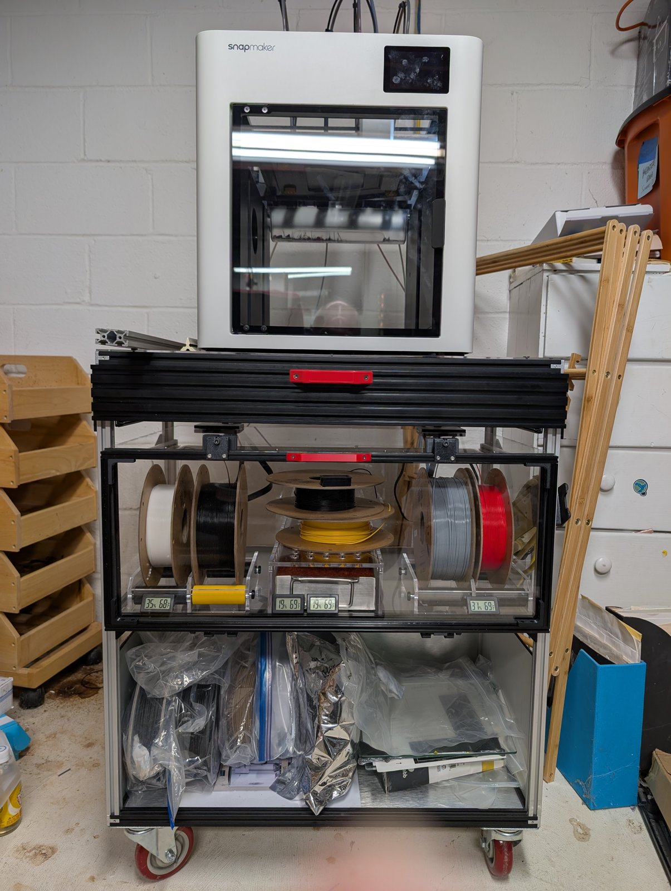

*2026-11-14, the first night: six hours after sealing, still drying (19 to 35 %), no fan yet.*

## Built

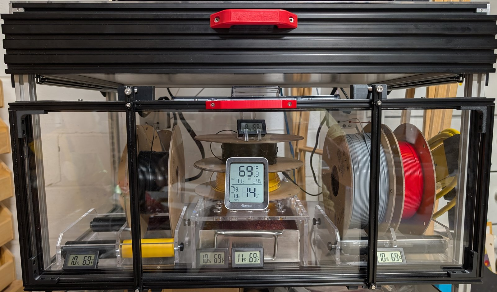

*2026-11-22: the door latched on its two 1010 uprights with M5 x 45 screws, before their printed knobs.*

| | |
|---|---|
| 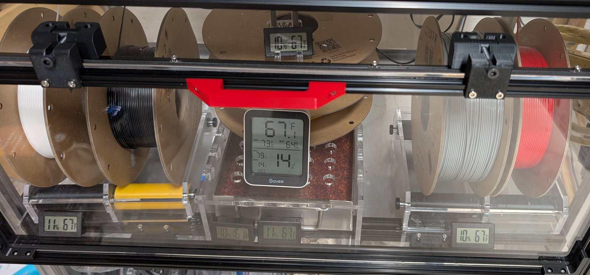 | 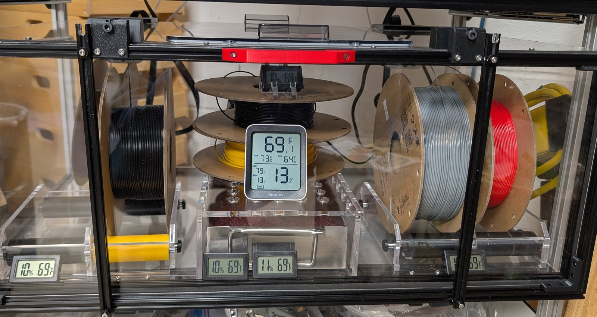 |
| 2026-11-19, a day after the fan went in: small hygrometers 10 to 11 %, reference 14 % | 2026-11-21: 10 to 11 %, reference 13 %; new uprights on, old catches not yet off |

| | |
|---|---|
| 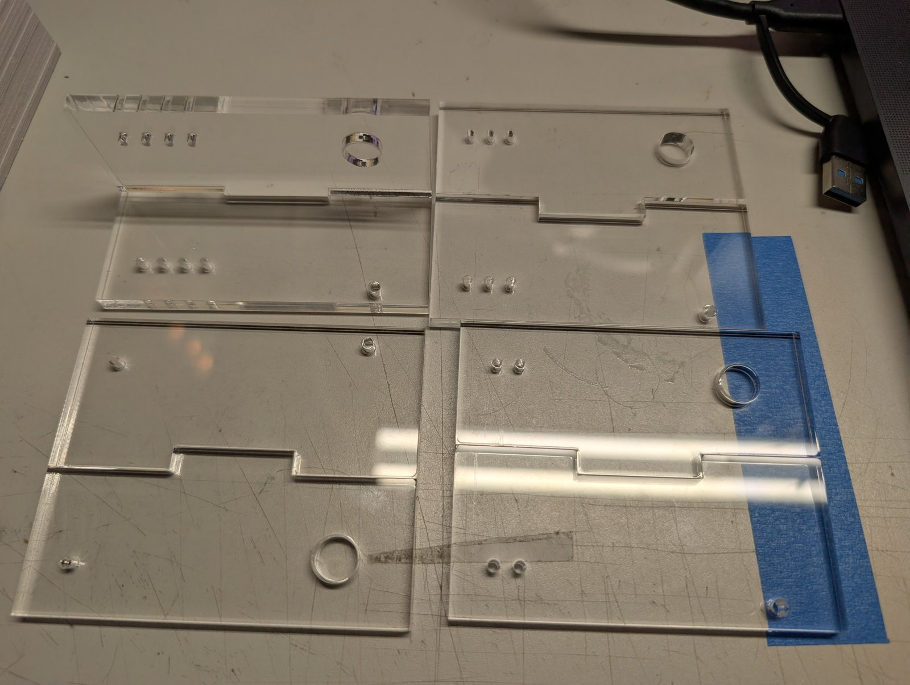 | 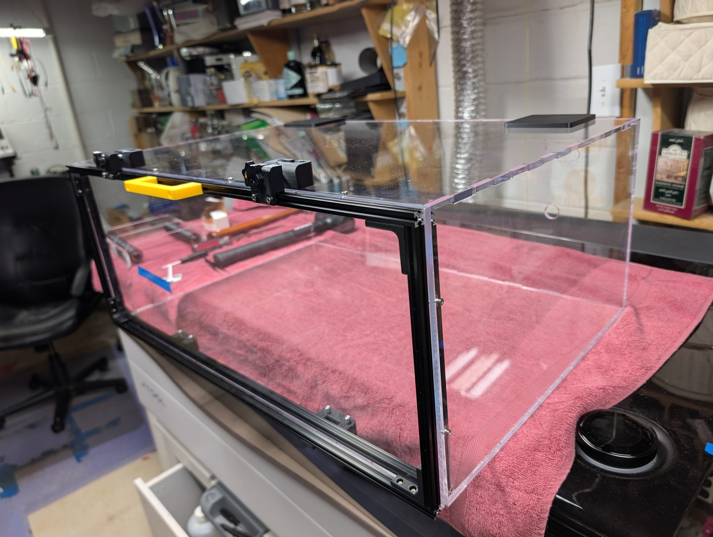 |
| Shell panels off the laser (film off, kerf 0.25) | Shell dry-fitted, door frame VHB-bonded to the door |
| 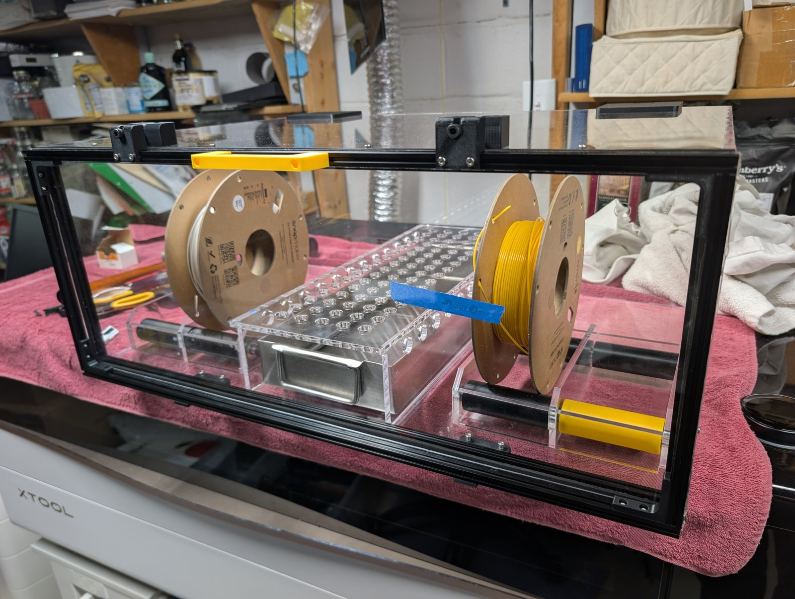 | 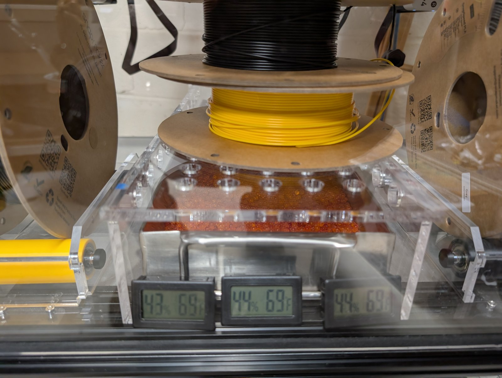 |
| First test fit on the bench | Gel loaded under the deck; 43 to 44 % RH at seal-up |
| 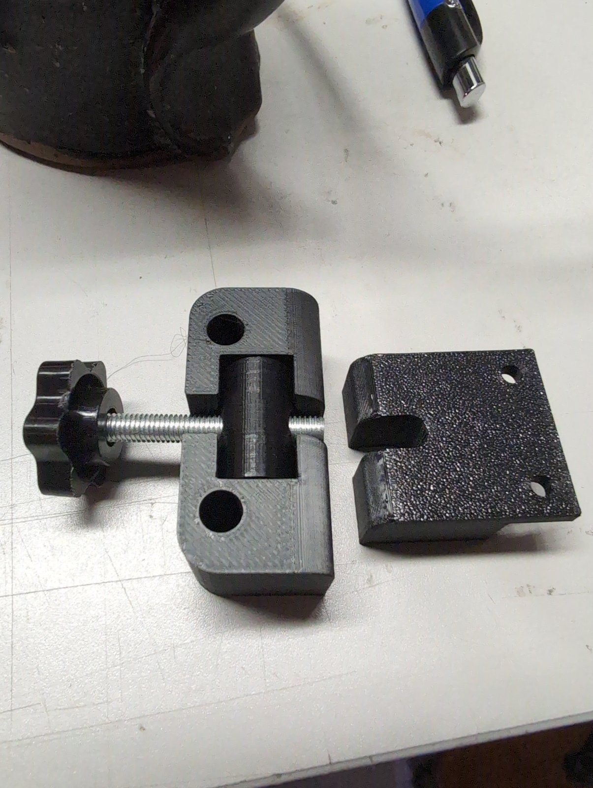 | 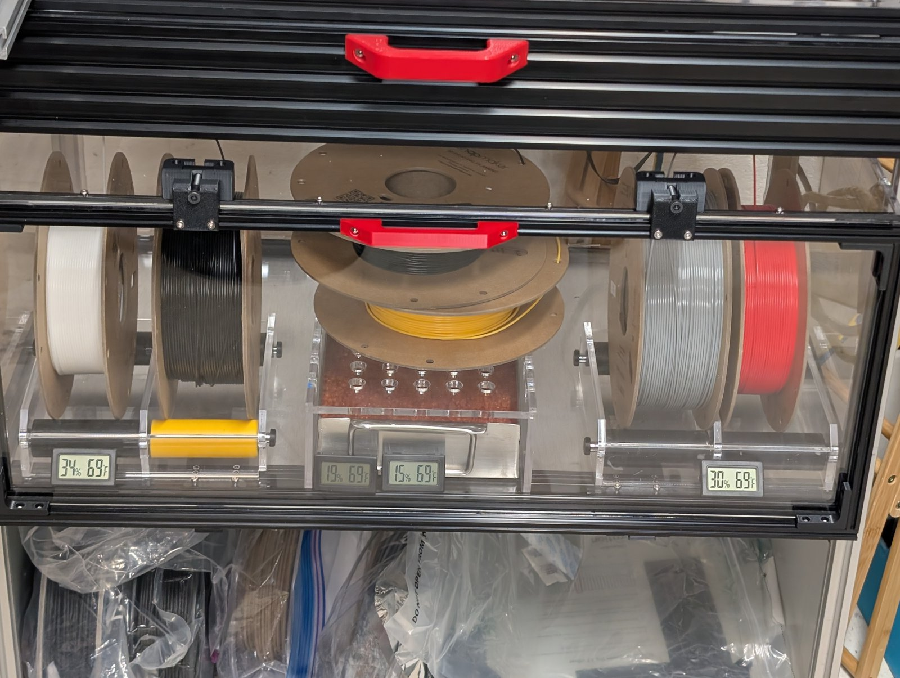 |
| Printed swing-bolt latch (catch since replaced by an upright) | 2026-11-14, three hours after sealing: 15 to 19 % by the pan, 30 to 34 % at the sides |

Lessons from the build:
- Kerf 0.25 was too tight for the long finger joints: the shell only closed with a mallet. Use
  about 0.20 on a re-cut.
- The butt-jointed tunnel needed printed jigs to glue square. Next time: tabs into slots, like the shell.
- Moving the feeders lengthens the filament path, so the U1's fixed load distance stops short of the
  toolhead. Either match the stock tube length or raise `preload_length` in the printer config:
  [`2026-11-22_feed_length.md`](2026-11-22_feed_length.md) has the how-to and a page that puts it
  back after firmware updates.
- The printed catches let the knob's pull twist the door frame's top rail. A 1010 upright from the
  bottom rail to each knob carries the pull to the hinge rail instead:
  [`2026-11-21_door_uprights.md`](2026-11-21_door_uprights.md).
- With no fan, the air by the gel dries first. After four days the pan was at 10 % but the sides and
  top were still at 15 to 17 %. With a small mixing fan, the whole box was at 10 to 13 % the next
  morning.

## Humidity log

Every reading from first seal (2026-11-14) to 2026-11-24, with the mixing fan, the uprights and a reel swap marked.

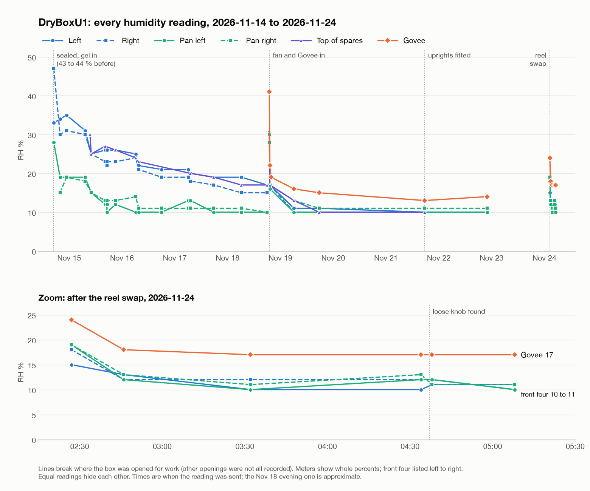

Numbers: [`data/2026-11-24_humidity_readings.csv`](data/2026-11-24_humidity_readings.csv) (RH in %, the box's
temperature in F where it was noted). `left` to `right` are the small hygrometers along the front, `top` the one on
the stacked spares, `govee` the reference. The small ones read about 4 below the Govee, which settles
slowly: the last reading still had it at 17 %, under three hours after the reel swap. Times are when each reading
was reported.

## The design

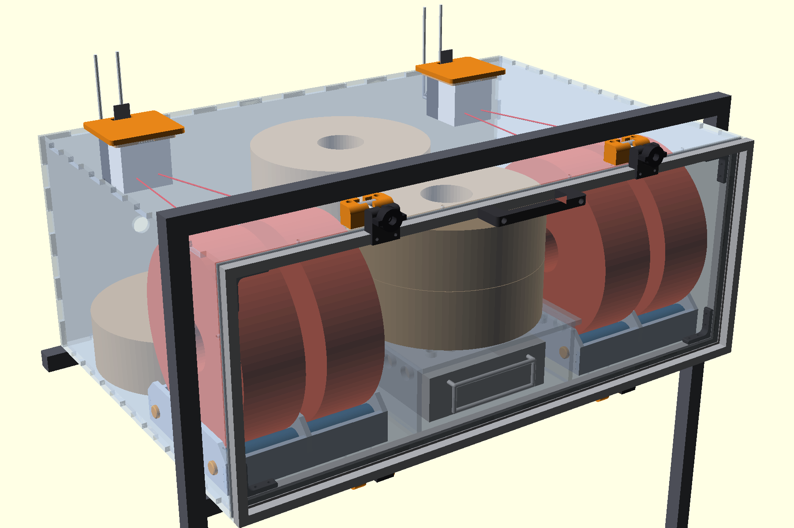

## What it does

| | |
|---|---|
| Spools spinning, feeding the printer | 4 (2 per feeder) |
| Spools in dry storage | 6 (4 on the deck, 2 on the floor) |
| Desiccant | about 2.6 L of indicating silica gel in a 15 x 6 x 2 in stainless pan |
| Outside size | 640 x 430 x 258 mm (fits a 648 mm opening) |
| Recharging | pull the pan out by its handle, bake at 225 to 250 F, slide it back |

## A tour

### Door open

The door hinges along its **bottom** edge on an 8 mm steel bar and swings down out of the way,
resting open by gravity (no prop). Everything inside is in reach: the four feeding spools on their
rollers, the stacked spares, and the desiccant pan's handle right at the front.

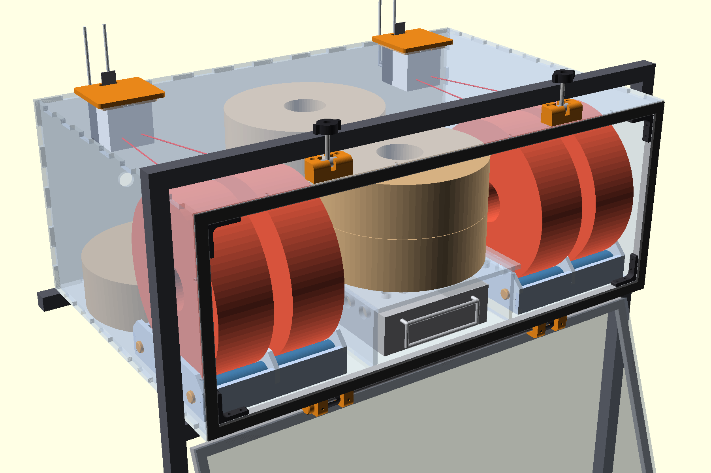

### From above (lid off)

Left and right: two laser-cut spool holders, each spinning a pair of spools on printed rollers with
608 bearings. The red lines are the filament paths up to the feeders in the back corners. Centre:
spare spools stacked on a perforated acrylic deck, with the desiccant tunnel underneath. Dry air
reaches the spools through the deck holes and the vents along the tunnel walls.

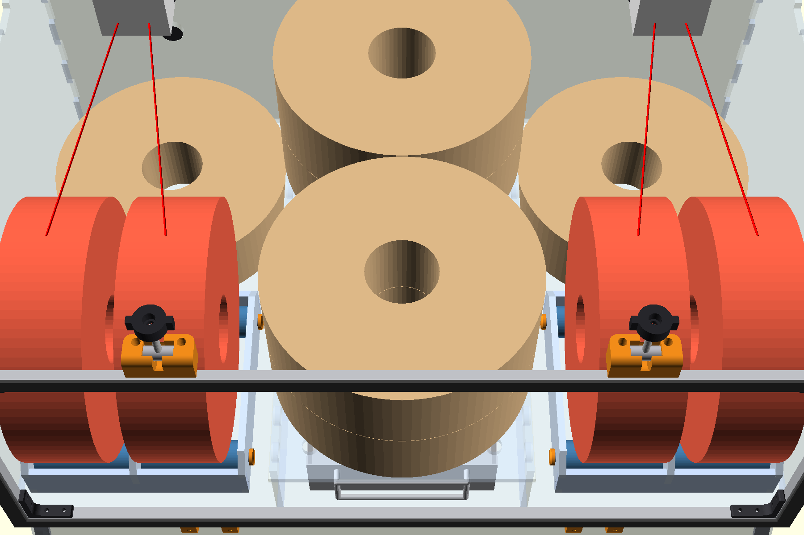

### From the back

The U1's two feeders hang on printed inserts in the top panel, with their outlets sealed through
the back wall. The render shows a PG13.5 cable gland in the back panel; as built, a printed split
gland takes its place and carries the mixing fan's USB cable. Two more spares tuck into the floor corners under the spinning spools.

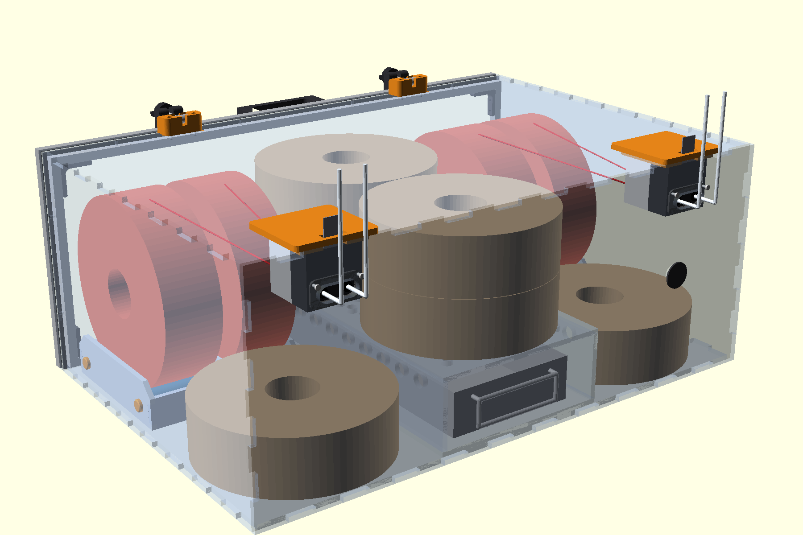

## The interesting bits

### Hinge with an adjustable seal

The door frame is 1010 extrusion bonded to the acrylic door with VHB tape. Two printed hinge rings
on the frame wrap a steel bar that rides in printed loops under the box. Each loop has a short slot
for the bar and two M3 grub screws bearing on it through captured nuts: turn them in and the bar
moves back, pulling the door's bottom edge into the EVA foam seal (0.5 mm per turn, 3 mm of travel).
The rings are full circles with crush ribs, so the hinge glides without play.

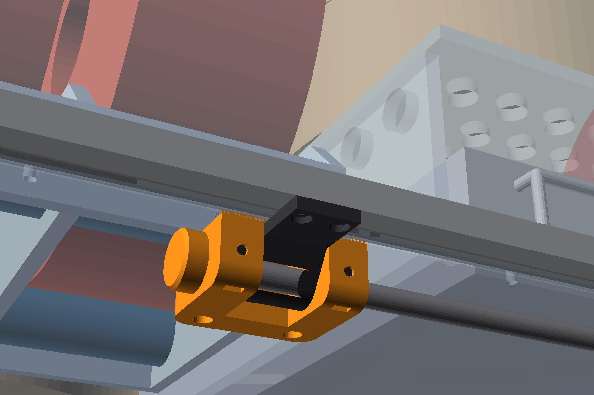

### Swing-bolt latches

At the top, two printed saddles each hold a 12 mm barrel on a pivot. Swing the bolt up into the
catch on the door frame, spin the knob down, and the door is pulled into the foam. Loosen the knob
and swing the bolt back to open. (Built: the printed catches were replaced by 1010 uprights with a
slotted top end, see [`2026-11-21_door_uprights.md`](2026-11-21_door_uprights.md).)

| Latched | Released |
|---|---|
| 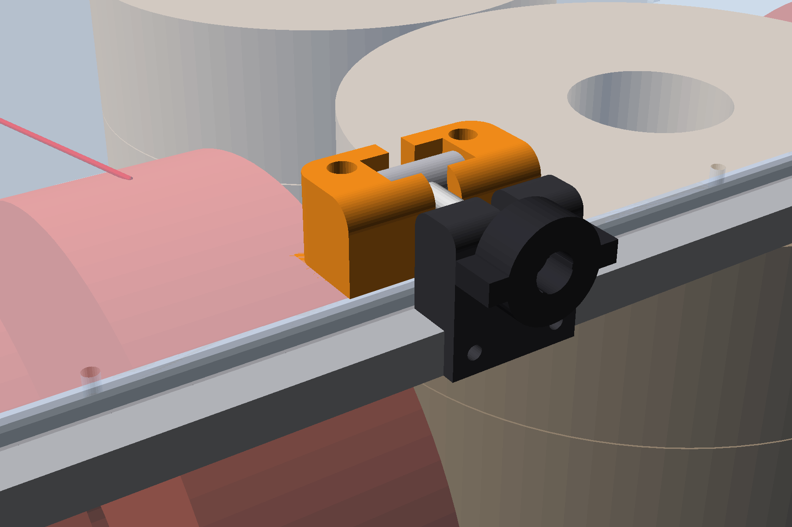 | 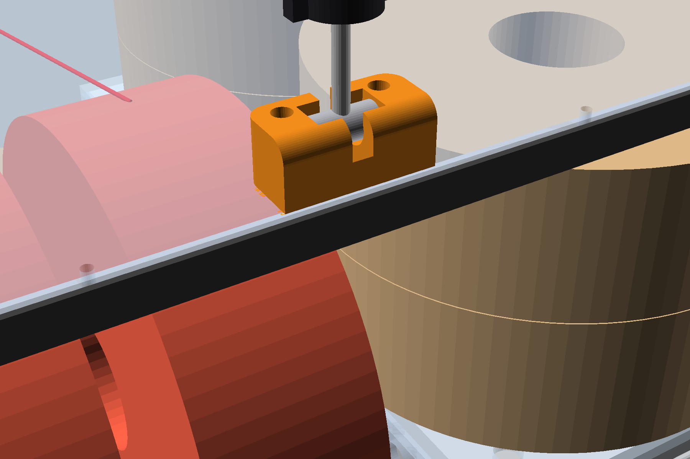 |

### Spool holders

Three acrylic plates and two 35 mm base strips at the plate ends, solvent-cemented: the strips' end
tabs sit in open-ended slots in the outer plates, and a half-lap joins them to the middle plate. Two
8 mm rods run through all three plates; each rod carries two printed rollers on 608 bearings, so one
holder spins two spools independently. Push-on printed end caps (three crush ribs, tuned by test
prints to 7.8 mm) keep the rods in; each rod bottoms in its caps before a cap reaches the acrylic.
The two holders are the same part, one turned end for end, and they simply sit on the floor.

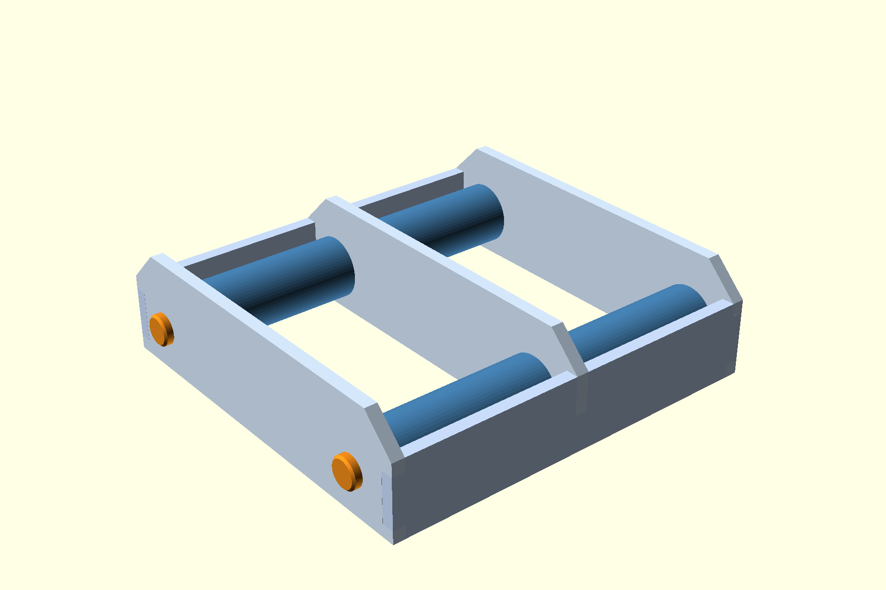

### Fits are measured, not guessed

Every press fit was settled with small test prints before committing: rod end caps at 7.7, 7.8 and
7.9 mm (7.8 won), hinge ring bore, nut pockets from measured nuts, the feeder insert through 11
versions. The laser kerf (0.25 mm) and hole kerf (0.10 mm) come from a cut coupon on the same
acrylic, and every acrylic sheet's thickness was caliper-mapped (5.8 mm, not 6).

## How it's made

**Bought:** 4 sheets of 24 x 36 in, 6 mm cast acrylic (3 for the shell, 1 for the inside), 1010
extrusion and T-nuts, 8 mm steel rod, 608ZZ bearings, M3 / M5 hardware, 3M 4910 VHB, EVA foam tape,
a 120 mm USB fan with a speed controller, and an Elite Global Solutions SS6152 stainless pan. Full list in
[`2026-11-05_hardware_list.md`](2026-11-05_hardware_list.md).

**Laser:** the shell is six finger-jointed panels nested on strips ripped from three sheets; the
interior (tunnel, deck, holder plates) nests on the fourth. Film comes off before cutting.

**Printed:** hinge loops and rings, latch saddles, barrels and knobs, the fan cable's split gland, the door handle, corner
brackets (door frame only; the shell panels screw straight to the shell frame),
feeder inserts, rollers, washers and end caps. STLs in [`stl/`](stl/), named `<part>_qty=<n>.stl`
with the count per box.

## Files

OpenSCAD 2021.01. Units mm. Every file starts with the date it was created (`yyyy-mm-dd_name`), and
each `.scad` file's header says what it is and which `part` / `view` options it has.

| File | What |
|---|---|
| [`2026-11-03_dry_box_assembly.scad`](scad/2026-11-03_dry_box_assembly.scad) | The whole box, for viewing (toggles: lid, door angle, spools, cart frame); prints the cut list |
| [`2026-10-30_dry_box_panels.scad`](scad/2026-10-30_dry_box_panels.scad) | Shell: dimensions, finger joints, every hole; panel outlines for the laser |
| [`2026-10-30_dry_box_sheets.scad`](scad/2026-10-30_dry_box_sheets.scad) | Shell panels nested on the ripped strips |
| [`2026-11-05_interior.scad`](scad/2026-11-05_interior.scad) | Tunnel, deck and holder plates nested on the interior sheet; feeder gaskets |
| [`2026-11-04_spool_holder.scad`](scad/2026-11-04_spool_holder.scad) | Spool holders, rollers, washers, rod end caps |
| [`2026-11-04_door_mounts.scad`](scad/2026-11-04_door_mounts.scad) | Hinge loop, seal adjusters, ring, bar and caps; door uprights and 4-fin knob (and the old catch); handle |
| [`2026-11-03_swing_latch.scad`](scad/2026-11-03_swing_latch.scad) | Latch saddle and barrel |
| [`2026-11-02_feeder_insert.scad`](scad/2026-11-02_feeder_insert.scad) | Feeder insert v11 (released) |
| [`2026-10-31_dry_box_bracket.scad`](scad/2026-10-31_dry_box_bracket.scad) | 1010 corner bracket |
| [`2026-11-11_tunnel_jig.scad`](scad/2026-11-11_tunnel_jig.scad) | Printed jig that holds the tunnel walls square while the cement cures |
| [`2026-11-14_collet_tool.scad`](scad/2026-11-14_collet_tool.scad) | Acrylic pusher that rides on the feeder tubes and presses both collet releases |
| [`2026-11-14_tapered_handle.scad`](scad/2026-11-14_tapered_handle.scad) | Tapered door handle (screws on the 45 degree ends), matches the cart's red handle |
| [`2026-11-16_fan_gland.scad`](scad/2026-11-16_fan_gland.scad) | Split threaded gland for a mixing fan's USB cable, in place of the PG13.5 |
| [`2026-11-17_hygrometer_stand.scad`](scad/2026-11-17_hygrometer_stand.scad) | Laser-cut stand for the reference hygrometer (three pieces, half-laps, no glue) |
| [`2026-11-21_four_spool_cart.scad`](scad/2026-11-21_four_spool_cart.scad) | Concept: a narrower 4-spool version on a 2020 cart with casters and a shelf under the spools |
| [`2026-11-05_hardware_list.md`](2026-11-05_hardware_list.md) | Fasteners, bought parts, printed parts |
| [`2026-11-11_cut_checklist.md`](2026-11-11_cut_checklist.md) | Every saw and laser cut, in order: acrylic rips, laser strips, rods, 1010 |
| [`2026-11-21_door_uprights.md`](2026-11-21_door_uprights.md) | Cut and drill sheet for the two 1010 door uprights that replace the printed catches |
| [`2026-11-22_feed_length.md`](2026-11-22_feed_length.md) | U1 printer setting for the longer feed path (`preload_length`), and a page on the printer that checks it and puts it back after firmware updates |

All `.scad` files live in [`scad/`](scad/); open them from there (the assembly imports STLs from
`../stl/`). The other `.scad` files are concepts, gauges, fit tests and views from along the way, kept
for the record; superseded ones say so in their headers.

- [`cut/`](cut/): laser files (SVG) exactly as staged for cutting, plus the cut list.
- [`stl/`](stl/): the current printed parts only, one file per part, quantity in the name. Fit tests
  and superseded versions are in the git history. The assembly imports a few of them.
- [`viewer/`](viewer/): a 3D view of the box that opens in a browser (rotate, zoom, pan).
- [`tools/`](tools/): the feed length page that runs on the printer (see the feed length guide).
- [`data/`](data/): the humidity and temperature log (CSV).
- [`images/`](images/): the pictures in this README. Earlier renders (the design's visual log) are in
  the git history.

## Before cutting

Nothing gets cut until every design choice is closed ("you can't uncut"). The shell, rods, 1010 and
interior (tunnel narrowed to the measured pan, acrylic tray dropped) are closed: see
[`2026-11-11_cut_checklist.md`](2026-11-11_cut_checklist.md).

## Why not just buy one?

A commercial four-spool dryer exists for about $279. But builders gotta build.

## License

[MIT](LICENSE), for everything in this repo: the OpenSCAD sources, STLs, laser files, guides, pictures
and the feed length page. Build it, change it, share it, sell it; just keep the copyright notice.
