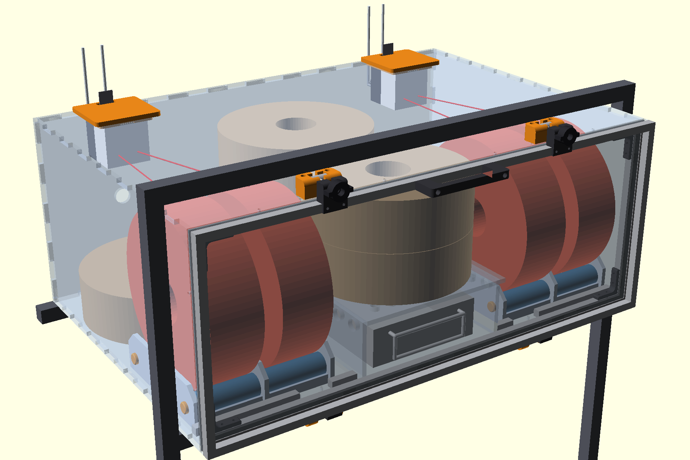
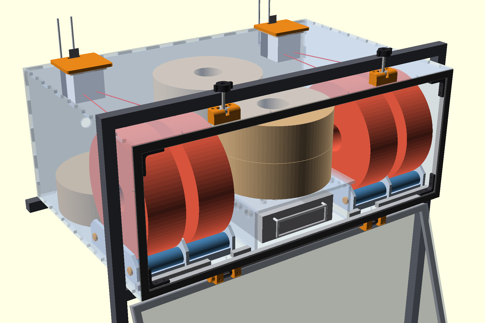
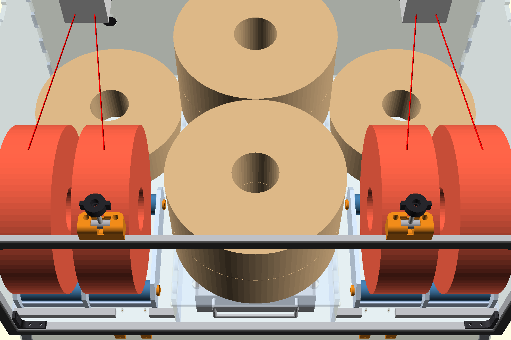
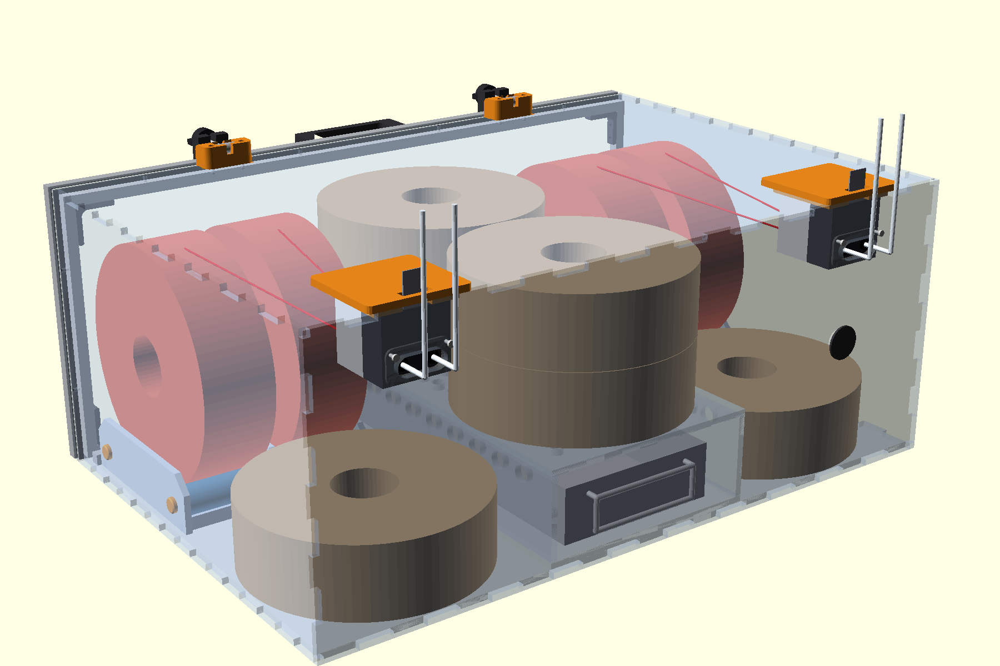
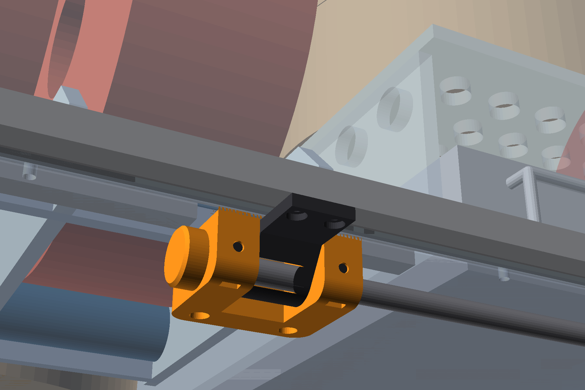
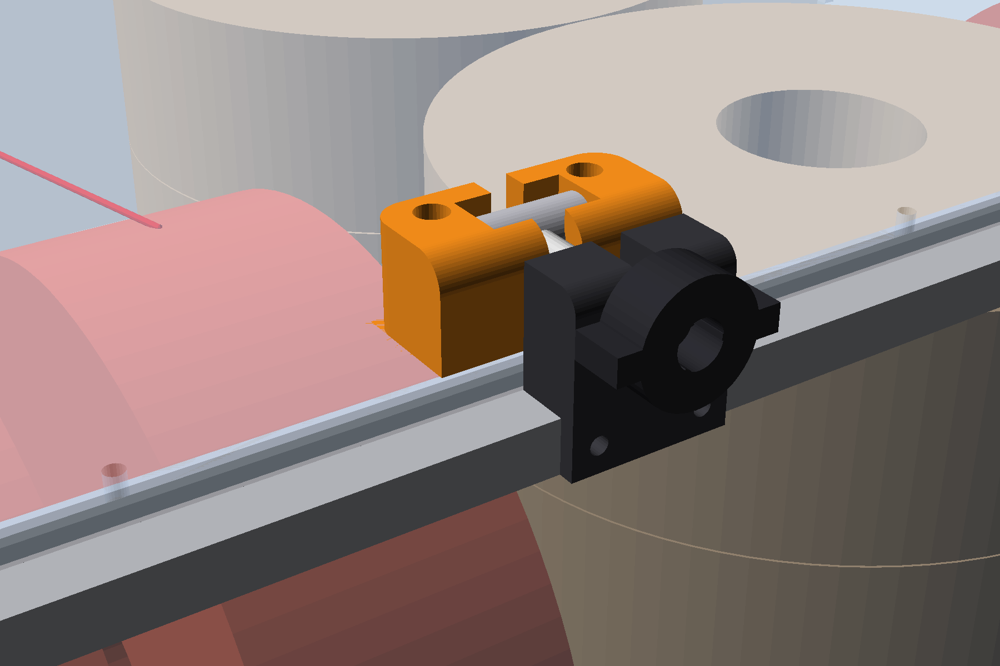
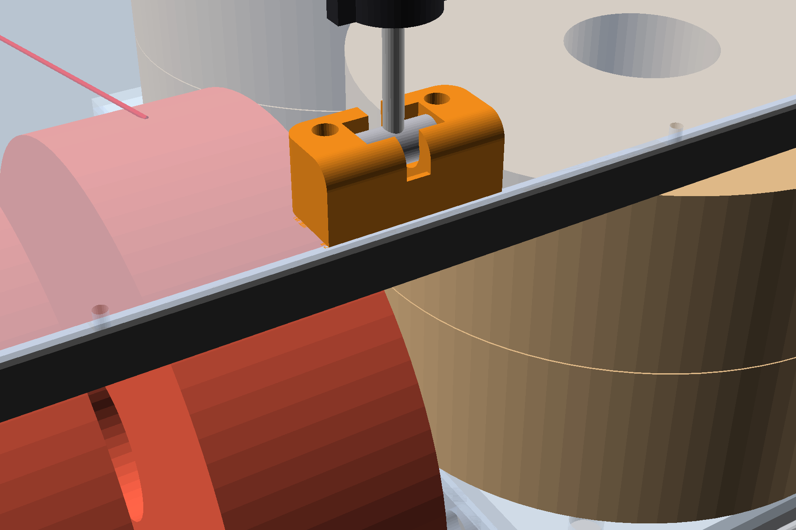
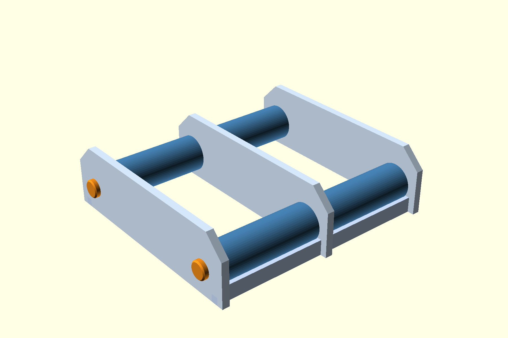

# DryBoxU1

A sealed, desiccant-dried filament box for a **Snapmaker U1**, built to fill the middle bay of the
printer cart. Four spools spin on rollers and feed the U1's two feeders straight through the back
wall, six more spools wait in dry storage, and a stainless pan of silica gel sits in a tunnel under
the floor deck. No heater, no fan, no electronics: just a good seal and enough desiccant.

Laser-cut 6 mm cast acrylic, a 1010 aluminium extrusion door frame, and a handful of 3D-printed
parts. Designed parametrically in OpenSCAD; every part was fit-tested on the printer before
anything gets cut.

> **Status (2026-11-07):** design nearly closed. Printed parts tested; acrylic not cut yet.
> Waiting on the desiccant pan to arrive so the tunnel can be sized to it. Renders show the pan at
> its assumed size.

## What it does

| | |
|---|---|
| Spools spinning, feeding the printer | 4 (2 per feeder) |
| Spools in dry storage | 6 (4 on the deck, 2 on the floor) |
| Desiccant | about 2.6 L of indicating silica gel in a 15 x 6 x 2 in stainless pan |
| Outside size | 640 x 430 x 258 mm (fits a 648 mm opening) |
| Recharging | pull the pan out by its handle, bake at 225 to 250 F, slide it back |

## A tour

### Door open

The door hinges along its **bottom** edge on an 8 mm steel bar and swings down out of the way,
resting open by gravity (no prop). Everything inside is in reach: the four feeding spools on their
rollers, the stacked spares, and the desiccant pan's handle right at the front.

### From above (lid off)

Left and right: two laser-cut spool holders, each spinning a pair of spools on printed rollers with
608 bearings. The red lines are the filament paths up to the feeders in the back corners. Centre:
spare spools stacked on a perforated acrylic deck, with the desiccant tunnel underneath. Dry air
reaches the spools through the deck holes and the vents along the tunnel walls.

### From the back

The U1's two feeders hang on printed inserts in the top panel, with their outlets sealed through
the back wall. A PG13.5 cable gland in the back panel stays closed on a rod stub, ready if a heater
is ever needed. Two more spares tuck into the floor corners under the spinning spools.

## The interesting bits

### Hinge with an adjustable seal

The door frame is 1010 extrusion bonded to the acrylic door with VHB tape. Two printed hinge rings
on the frame wrap a steel bar that rides in printed loops under the box. Each loop has a short slot
for the bar and two M3 grub screws bearing on it through captured nuts: turn them in and the bar
moves back, pulling the door's bottom edge into the EVA foam seal (0.5 mm per turn, 3 mm of travel).
The rings are full circles with crush ribs, so the hinge glides without play.

### Swing-bolt latches

At the top, two printed saddles each hold a 12 mm barrel on a pivot. Swing the bolt up into the
catch on the door frame, spin the knob down, and the door is pulled into the foam. Loosen the knob
and swing the bolt back to open.

| Latched | Released |
|---|---|
|  |  |

### Spool holders

Three acrylic plates and two base strips, interlocked egg-crate style and solvent-cemented. Two
8 mm rods run through all three plates; each rod carries two printed rollers on 608 bearings, so one
holder spins two spools independently. Push-on printed end caps (three crush ribs, tuned by test
prints to 7.8 mm) keep the rods in. The two holders are the same part, one turned end for end.

### Fits are measured, not guessed

Every press fit was settled with small test prints before committing: rod end caps at 7.7, 7.8 and
7.9 mm (7.8 won), hinge ring bore, nut pockets from measured nuts, the feeder insert through 11
versions. The laser kerf (0.25 mm) and hole kerf (0.10 mm) come from a cut coupon on the same
acrylic, and every acrylic sheet's thickness was caliper-mapped (5.8 mm, not 6).

## How it's made

**Bought:** 4 sheets of 24 x 36 in, 6 mm cast acrylic (3 for the shell, 1 for the inside), 1010
extrusion and T-nuts, 8 mm steel rod, 608ZZ bearings, M3 / M5 hardware, 3M 4910 VHB, EVA foam tape,
a PG13.5 gland, and an Elite Global Solutions SS6152 stainless pan. Full list in
[`2026-11-05_hardware_list.md`](2026-11-05_hardware_list.md).

**Laser:** the shell is six finger-jointed panels nested on strips ripped from three sheets; the
interior (tunnel, deck, holder plates) nests on the fourth. Film comes off before cutting.

**Printed:** hinge loops and rings, latch saddles, barrels and catches, the door handle, corner
brackets (used to hold the door frame square while the VHB cures, then moved to the shell frame),
feeder inserts, rollers, washers and end caps. STLs in [`stl/`](stl/).

## Files

OpenSCAD 2021.01. Units mm. Every file starts with the date it was created (`yyyy-mm-dd_name`), and
each `.scad` file's header says what it is and which `part` / `view` options it has.

| File | What |
|---|---|
| [`2026-11-03_dry_box_assembly.scad`](2026-11-03_dry_box_assembly.scad) | The whole box, for viewing (toggles: lid, door angle, spools, cart frame); prints the cut list |
| [`2026-10-30_dry_box_panels.scad`](2026-10-30_dry_box_panels.scad) | Shell: dimensions, finger joints, every hole; panel outlines for the laser |
| [`2026-10-30_dry_box_sheets.scad`](2026-10-30_dry_box_sheets.scad) | Shell panels nested on the ripped strips |
| [`2026-11-05_interior.scad`](2026-11-05_interior.scad) | Tunnel, deck and holder plates nested on the interior sheet; feeder gaskets |
| [`2026-11-04_spool_holder.scad`](2026-11-04_spool_holder.scad) | Spool holders, rollers, washers, rod end caps |
| [`2026-11-04_door_mounts.scad`](2026-11-04_door_mounts.scad) | Hinge loop, seal adjusters, ring, bar and caps; door catch; handle |
| [`2026-11-03_swing_latch.scad`](2026-11-03_swing_latch.scad) | Latch saddle and barrel |
| [`2026-11-02_feeder_insert.scad`](2026-11-02_feeder_insert.scad) | Feeder insert v11 (released) |
| [`2026-10-31_dry_box_bracket.scad`](2026-10-31_dry_box_bracket.scad) | 1010 corner bracket |
| [`2026-11-05_hardware_list.md`](2026-11-05_hardware_list.md) | Fasteners, bought parts, printed parts |

The other `.scad` files are concepts, gauges, fit tests and views from along the way, kept for the
record; superseded ones say so in their headers.

- [`cut/`](cut/): laser files (SVG) exactly as staged for cutting, plus the cut list.
- [`stl/`](stl/): printed parts, including the fit tests. The assembly imports a few of them.
- [`renders/`](renders/) and the dated PNGs in the top folder: a visual log of the design.

## Before cutting

Nothing gets cut until every design choice is closed ("you can't uncut"). Still open:

- Measure the desiccant pan, then narrow the tunnel to it and drop the acrylic tray from the
  interior sheet.
- Fix the top and bottom panels' back corners: the corner cubes there are joined by a 0.25 mm
  pinch and would fall out, so they move to the back panel.
- Measure the PG13.5 gland thread for the back panel hole.
- Test-cut a feeder gasket and one holder plate.

## Why not just buy one?

A commercial four-spool dryer exists for about $279. But builders gotta build.
